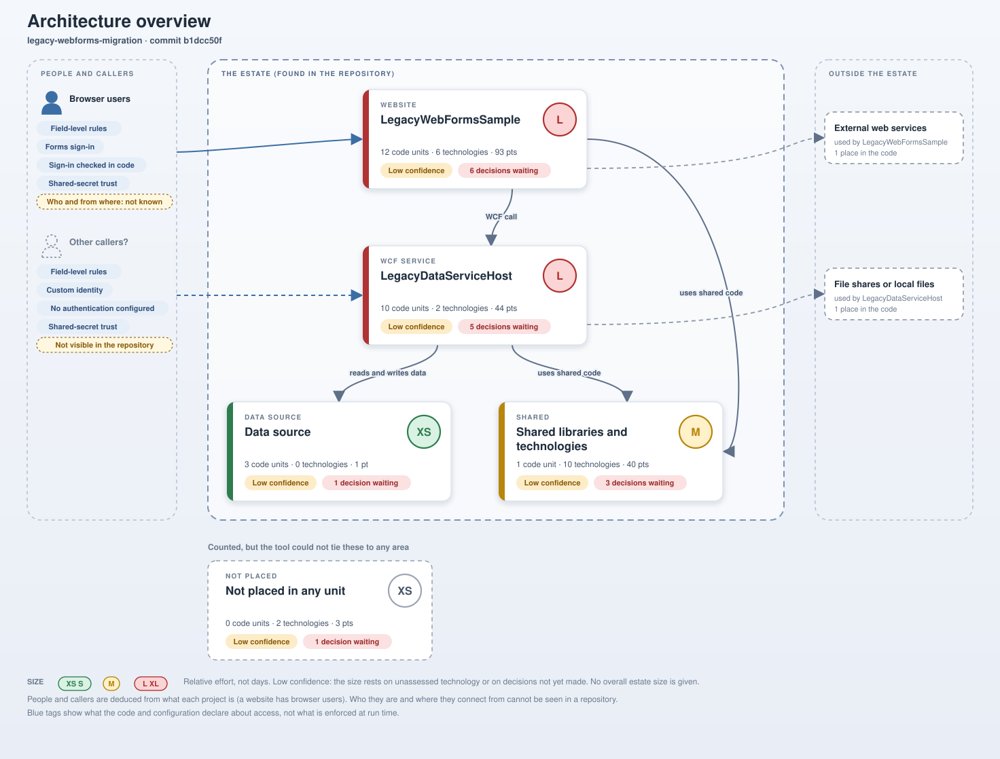
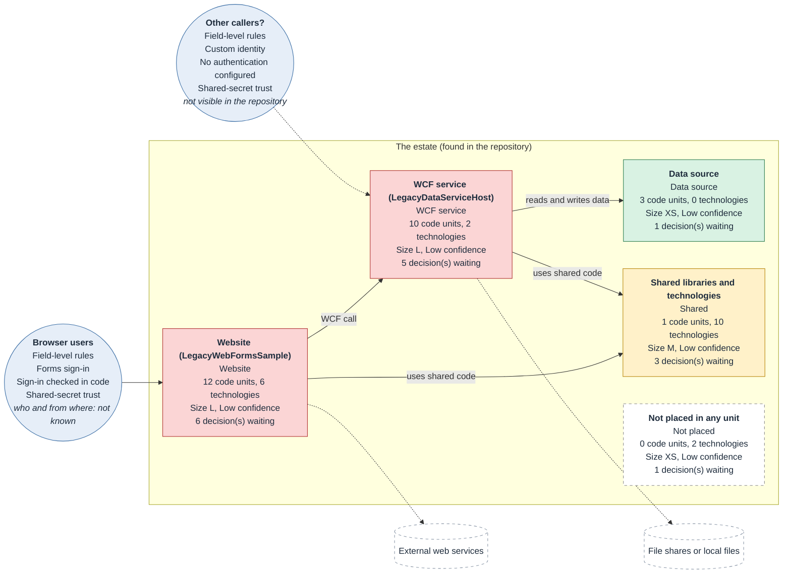
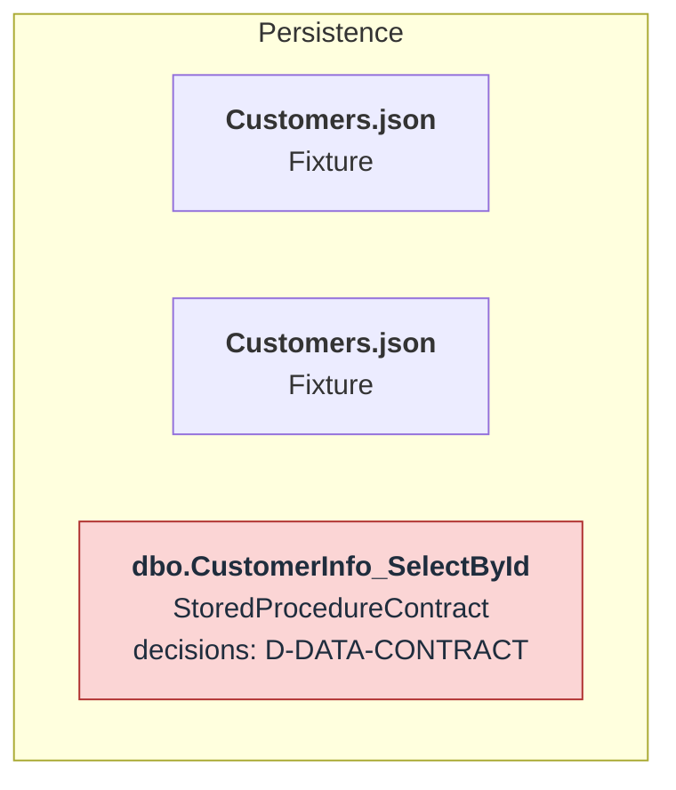
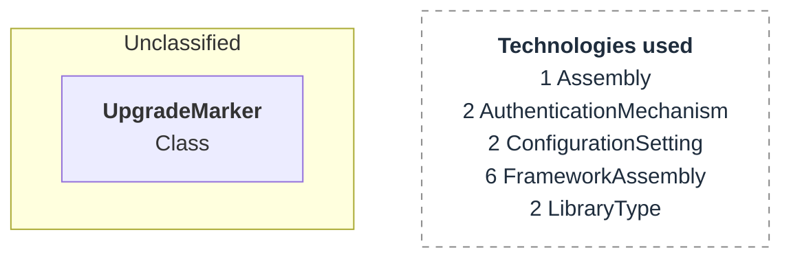
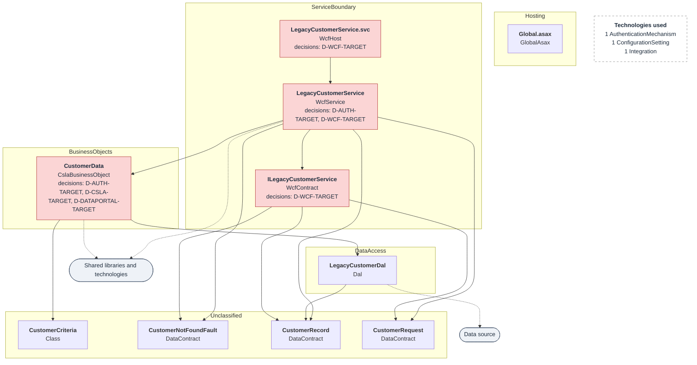
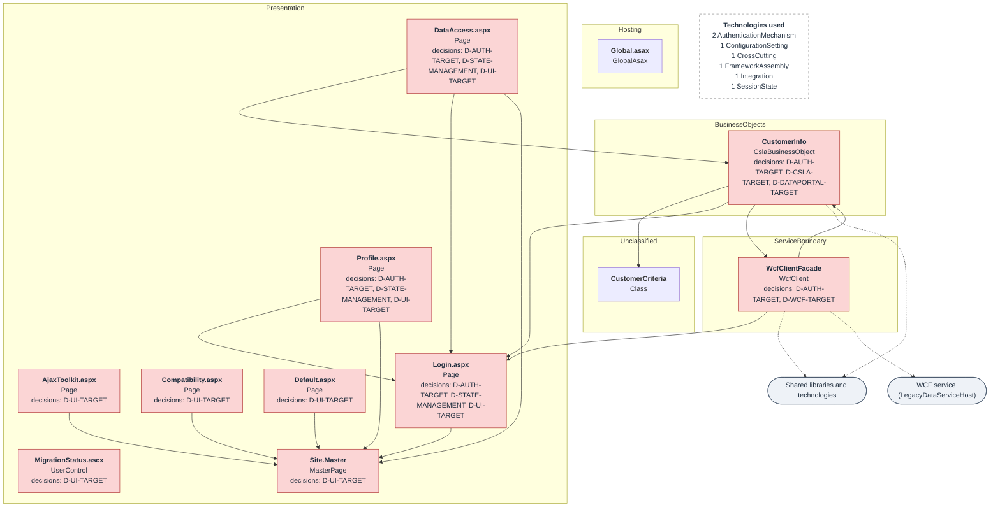

# Architecture: legacy-webforms-migration

Commit b1dcc50fa9dbfc95fe4a51fe5b96b20ae70d7e65. Drawn from the deterministic analysis; every box and arrow is something the tool found.

## Overview

### How to read this

- **Cards** are the deployable parts of the estate. The coloured bar and badge show relative size, and the chips show confidence and open decisions. There is no overall size for the estate.
- **People and callers** (left) are deduced from what each project is. Who they are and where they connect from is not visible in a repository, so the diagram marks it as not known.
- **The dashed boundary** is the estate found in the repository. **Outside the estate** (right) holds the external systems the code reaches.
- **Arrows** point from a part to the part it depends on, labelled with the kind of link.

### Drill-down (Mermaid)

The same overview as a Mermaid diagram, then one diagram per part below.

## Data source

Red boxes wait on a decision. Dashed arrows go to other areas. Up to 25 components are drawn, those needing the most attention first.

## Shared libraries and technologies

Red boxes wait on a decision. Dashed arrows go to other areas. Up to 25 components are drawn, those needing the most attention first.

## WCF service (LegacyDataServiceHost)

Red boxes wait on a decision. Dashed arrows go to other areas. Up to 25 components are drawn, those needing the most attention first.

## Website (LegacyWebFormsSample)

Red boxes wait on a decision. Dashed arrows go to other areas. Up to 25 components are drawn, those needing the most attention first.

