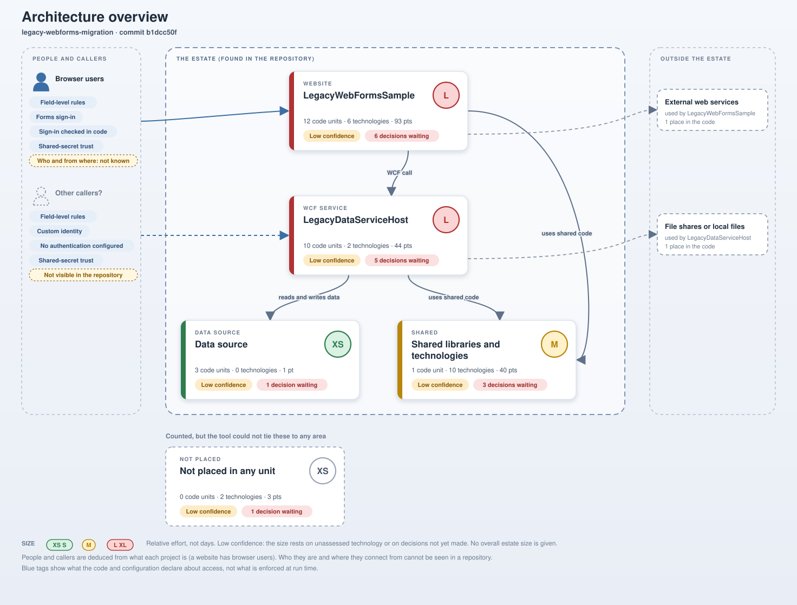

# Application estate summary: legacy-webforms-migration

_A plain-language view of what you have, what has to be decided, and what we could not see_

> legacy-webforms-migration is a .NET Framework estate of 4 projects written in VB.NET and C#. We found 2 deployable parts: WCF service (LegacyDataServiceHost) and website (LegacyWebFormsSample), along with the data it reads and some shared code. 2 parts are large pieces of work. 8 decisions only your team can make must be settled before work in those areas can start.

- Projects: 4 (VB.NET 3, C# 1).
- Platform: .NET Framework 4.8.
- What it contains: 6 web pages, 3 other classes, 3 data contracts, 2 business objects, 2 data files, 2 application start-up files, 1 data access class, 1 page template and 6 other kinds of item.
- Decisions needed from your team: 8.
- Things the analysis could not see: 9.

## The parts of your estate

| Part | What it is | What it contains | Size | Confidence |
|---|---|---|---|---|
| **Data source** | The database objects and data files the application reads. | 2 data files, 1 stored procedure. | Very small (XS) | Low |
| **Shared code** | Code and libraries used by more than one part of the estate. | 1 other class. Technologies: 6 framework libraries, 2 sign-in and access mechanisms, 2 configuration settings, 2 third-party library features, 1 third-party library. | Medium (M) | Low |
| **LegacyDataServiceHost** (WCF service) | A service that other applications call to get things done and to reach the data. | 3 data contracts, 1 other class, 1 business object, 1 data access class, 1 application start-up file, 1 service contract, 1 service host file, 1 service implementation. Technologies: 1 sign-in or access mechanism, 1 configuration setting, 1 link to an outside system. | Large (L) | Low |
| **LegacyWebFormsSample** (Website) | The user-facing web application. People reach it through a browser. | 6 web pages, 1 other class, 1 business object, 1 application start-up file, 1 page template, 1 reusable page component, 1 service client. Technologies: 2 sign-in and access mechanisms, 1 configuration setting, 1 shared concern (such as time handling), 1 framework library, 1 link to an outside system, 1 use of session state. | Large (L) | Low |
| **Items not placed** | Items the analysis counted but could not tie to any one part. | Technologies: 2 sign-in and access mechanisms. | Very small (XS) | Low |

## How the parts fit together

- Browser users reach the website (LegacyWebFormsSample). The project serves web pages.
- The WCF service (LegacyDataServiceHost) reads and writes data in the data source.
- The WCF service (LegacyDataServiceHost) uses the shared code.
- The website (LegacyWebFormsSample) uses the shared code.
- The website (LegacyWebFormsSample) calls the WCF service (LegacyDataServiceHost).
- The website (LegacyWebFormsSample) reaches external web services.
- The WCF service (LegacyDataServiceHost) reaches file shares or local files.
- What the WCF service (LegacyDataServiceHost) declares about access: Field-level read rules are declared in business objects. A custom identity is attached to each request. No authentication is configured here. A shared application secret is used to vouch for calls between applications. Roles named in code: Admin.
- What the website (LegacyWebFormsSample) declares about access: Field-level read rules are declared in business objects. Sign-in uses Forms authentication (declared in configuration). Code checks whether the user is signed in. A shared application secret is used to vouch for calls between applications. 2 location(s) require sign-in; anything else the configuration allows is open to anyone. Roles named in code: Admin.

## Decisions only your team can make

| Decision | Why it matters | Affects |
|---|---|---|
| How will users and services sign in after migration? | Sign-in is built on technology that does not carry over directly, and most parts of the estate touch it. | LegacyDataServiceHost, LegacyWebFormsSample, Shared code |
| What should the web pages be rebuilt with? | Web Forms has no direct equivalent in modern .NET, so this is the largest single choice for the website. | LegacyWebFormsSample |
| How should information remembered between page visits (session state) be handled? | The old approach depends on the web server remembering each user; modern hosting usually works differently. | LegacyWebFormsSample |
| What should replace the WCF service technology? | WCF is not carried forward into modern .NET in the same form, so the service and its callers need a new way to talk. | LegacyDataServiceHost, LegacyWebFormsSample |
| Will you keep the CSLA framework, upgrade it, or replace it? | CSLA shapes how the business logic is written, so this choice sets the pattern for that whole layer. | LegacyDataServiceHost, LegacyWebFormsSample, Shared code |
| What should replace the way the application reaches its business objects (the CSLA data portal)? | It decides whether the website still talks to the service through business objects or through something simpler. | LegacyDataServiceHost, LegacyWebFormsSample, Shared code |
| Is any change to the data the service sends and receives acceptable? | Other applications may depend on its exact shape, so any change needs agreement first. | Data source |
| Where will files live after migration (local disk, a shared drive or cloud storage)? | The code reads and writes files directly, and the answer depends on where the new system is hosted. | LegacyDataServiceHost |

## Main risks

- Work in Data source, Shared code, LegacyDataServiceHost and LegacyWebFormsSample cannot be sized firmly until the decisions above are made, so today's sizes are indications, not commitments.
- 10 components will have to be redesigned rather than upgraded (5 in LegacyWebFormsSample, 3 in Shared code). These are where most of the effort and risk sit.
- The website (LegacyWebFormsSample) is linked directly to code that belongs to another part, as well as calling it. The two cannot be migrated independently until that link is understood.
- A service declares no authentication in its configuration and appears to rely on a shared application secret. How callers are trusted needs to be decided deliberately in the new design.

## What we could not see

These are not assumed to be fine. Each is a question for your team.

- A project exists in the repository that is not part of any solution, so it was not analysed. Is it still used?
- The code calls database stored procedures whose definitions are not in the repository. The definitions are needed from the database to assess the data layer.
- How will existing data be migrated, and how will the cutover be managed?
- How is the application built, packaged and deployed today?
- How much automated testing exists today?
- Are there compliance or audit requirements the migration must meet?
- Are there non-technical constraints, such as budget, deadlines, skills or contracts?
- LegacyDataServiceHost: Do other applications or partners call the service, and from which networks?
- LegacyWebFormsSample: Are the users staff, customers or the public, and do they connect from the internet or an internal network?
- In 7 further areas nothing was detected, which may mean none exists or that it lives outside the code (for example scheduled tasks or server settings). The technical report lists them.

## Suggested next steps

1. Answer the questions under "What we could not see". They are things only your team can tell us, and several change the size of the work.
2. Hold short decision sessions for the 8 decisions above, starting with: "How will users and services sign in after migration?", "What should the web pages be rebuilt with?" and "How should information remembered between page visits (session state) be handled?"
3. Turn the answers into a phased roadmap. The order the analysis suggests is: Data source, Shared code, LegacyDataServiceHost and LegacyWebFormsSample, because each part depends on the ones before it.
4. Before anything is changed, capture how the key user journeys behave today, so the migrated version can be checked against them.

---

_This summary comes from an automated analysis of the source code at commit b1dcc50f. It reads code and configuration; it does not build or run anything, and it keeps no source code or database text. Sizes are relative effort indicators, not days or cost, and no overall size is given for the estate. Statements about access describe what the code and configuration declare, not what is enforced when the system runs. A technical report with the evidence behind every statement is available._
